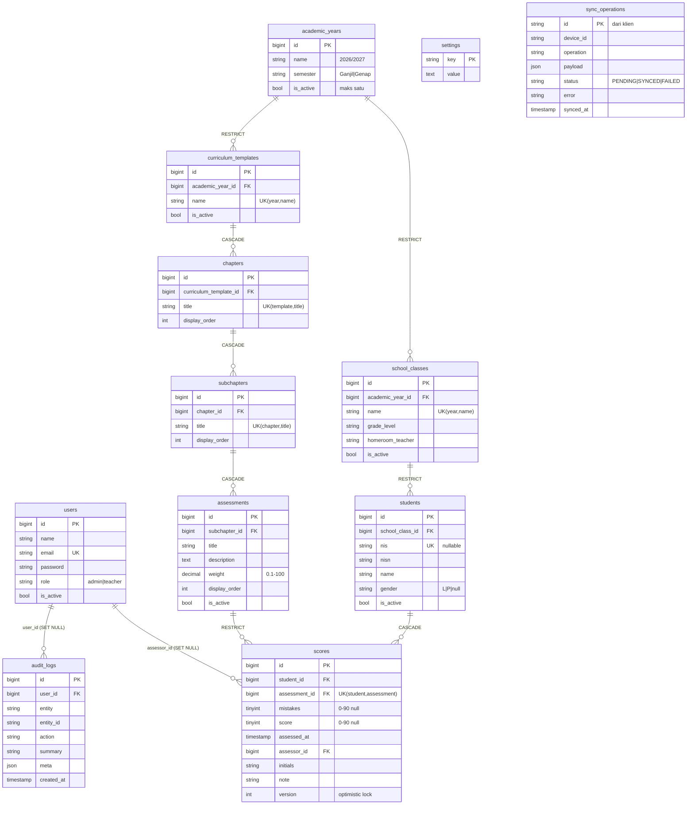

# ERD — PIB Penilaian

Diagram dirender oleh GitHub/GitLab/VS Code (Mermaid). Detail kolom: [SCHEMA.md](SCHEMA.md).

## Aturan relasi yang penting

| Relasi | Perilaku hapus | Mengapa |
|---|---|---|
| `scores.assessment_id → assessments` | **RESTRICT** | Struktur kurikulum yang sudah bernilai tidak boleh hilang lewat cascade |
| `scores.student_id → students` | CASCADE | Hapus permanen siswa (dikonfirmasi) membawa nilainya |
| `students → school_classes`, `school_classes → academic_years`, `curriculum_templates → academic_years` | RESTRICT | Data induk yang dipakai harus dinonaktifkan, bukan dihapus |
| `chapters/subchapters/assessments` ke atasnya | CASCADE | Hapus template kosong membersihkan struktur; diblokir otomatis bila ada nilai (rantai RESTRICT di atas) |
| `scores.assessor_id`, `audit_logs.user_id` | SET NULL | Menghapus akun tidak menghapus riwayat |

`settings`, `sync_operations` berdiri sendiri (tanpa FK). `individual_test_sessions*` dari aplikasi lama **tidak dibawa**.
